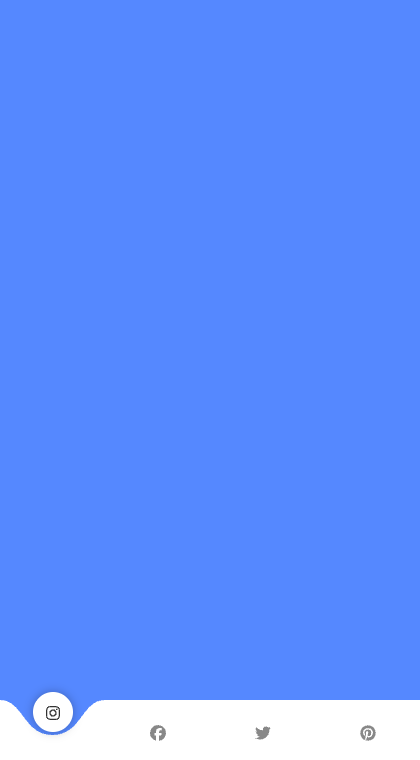
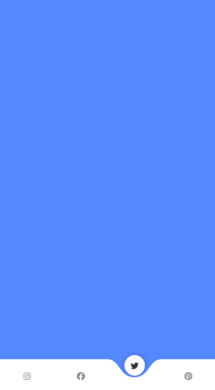

# UI Animation

An animated bottom navigation bar. The white bar carves a notch that slides to
whichever tab you select, and the active icon lifts up out of the notch.

<p align="center">
  
</p>

Stills, for viewers that block animation:

<p align="center">
  
  
</p>

## Requirements

Node `^20.19.0 || >=22.12.0` — required by Vite 8.

## Getting started

```bash
npm install
npm run dev
```

The dev server prints its URL (`http://localhost:5173/` unless that port is taken).

## Scripts

| Script | What it does |
| --- | --- |
| `npm run dev` | Vite dev server with hot module replacement |
| `npm run build` | Type-check, then emit a production bundle to `dist/` |
| `npm run preview` | Serve the built `dist/` locally to check the real bundle |
| `npm run typecheck` | Type-check only, no output |

There is no test suite. `npm run typecheck` is the only automated check.

## Stack

| | |
| --- | --- |
| UI | React 19 |
| Build | Vite 8 |
| Language | TypeScript 5.9, `strict` |
| Animation | `@react-spring/web` 10 |
| Icons | FontAwesome 7 (brands) |

## Layout

```
index.html        Vite entry point
src/main.tsx      Mounts <App> into #root
src/App.tsx       Everything: App, IconButton, Wave
src/styles.css    Plain CSS, no preprocessor
```

## How the animation works

Two independent springs drive the effect. A spring here is a number
react-spring animates from `0` to `1` over time; the code maps that progress
onto SVG coordinates and CSS values.

**The notch** is a single SVG `<path>`. `wave(x, y)` builds the full-width bar as
a rectangle with a rounded dip carved into its top edge at `x`, descending `y`
units. Animating `x` slides the notch sideways; animating `y` controls how deep
it cuts.

Each tab has a fixed anchor, `anchorFor(i) === (i + 1) * 90`, in viewBox units.
`App` keeps the last two anchors in state as a `[from, to]` tuple and passes it to
`Wave`, which picks one of three interpolations depending on the move:

| Case | `y` path | Effect |
| --- | --- | --- |
| First render | `0 → 35` | Notch drops into place |
| Adjacent tab (`distance <= 90`) | `35 → 35` | Slides across at full depth |
| Distant tab (`distance > 90`) | `35 → 0 → 35` | Lifts out, then sets back down |

Lifting the notch out keeps it from smearing across the intervening tabs on a
long jump.

The spring is declared with `reset: true`, so it replays from `0 → 1` on every
render rather than animating only on mount. A `holdUntilMoving` latch pins the
path to the previous anchor until the `x` spring actually starts moving, so the
notch never jumps ahead of its own animation.

**The active icon** runs a separate spring that translates it `-20px`, fades its
colour from `#888` to `#333`, and interpolates a drop shadow in over the last
20% of the transition. It is delayed 200ms so the notch arrives first.

## Known limitations

The geometry is hardcoded for exactly four tabs: the SVG viewBox is 360 units
wide and anchors are spaced 90 units apart. The bar stretches to any screen
width via `preserveAspectRatio="none"`, but adding or removing a tab means
reworking those constants; left as they are, the notch no longer lines up with
the buttons.
